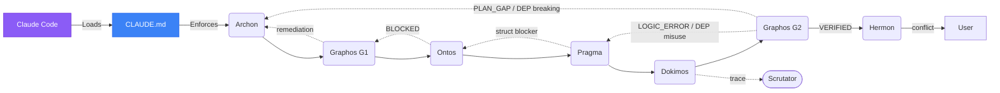

<div align="center">
# Claude Code Harness: Topos Protocol
**Implementing the 6-stage Topos Pipeline in Claude Code**
</div>


## 🌟 Status: Source of Truth
The Claude structure represents the most mature and complete implementation of the Topos Pipeline. Its multi-agent paradigm, featuring strict YAML frontmatter and explicit model mapping (e.g., `sonnet` for heavy logic, `haiku` for documentation/version control), serves as the **Canonical Source of Truth**. This architecture has been successfully replicated and adapted across all other harnesses (Codex, Antigravity, Gemini CLI) while respecting their specific form factors; `scripts/sync_roles.py` propagates the role bodies.

## 📌 Implementation
Claude Code relies on global context markdown instructions. This harness utilizes the `CLAUDE.md` master file to dictate the orchestration behavior.

The pipeline runs in **Full** mode (all six agents) or **Short** mode (Archon and Ontos
dropped; the orchestrator plans inline) — see `CLAUDE.md` → PRIORITY → P2.




## 🏗️ Agent Formatting (Source of Truth)
In Claude Code, subagents are NOT just standard markdown files. To be recognized as an invocable, routable subagent, the file **MUST** contain a YAML frontmatter block at the very top.

**Format Pattern (`<Agent>.md`):**
```markdown
---
name: <AgentName>
description: <Short description of what the agent does and when to route to it>
model: sonnet  # sonnet for Archon/Ontos/Pragma/Dokimos; haiku for Graphos/Hermon
permissionMode: acceptEdits    # one of: default, acceptEdits, plan, bypassPermissions, dontAsk
---

# <AgentName> Agent
Role: ...
[Your markdown instructions here...]
```
If an agent lacks this YAML block, it is effectively invisible to the routing table and cannot be spawned as a subagent.

Only `name` and `description` are required; the other fields are defaults. Agent files do **not** schedule the pipeline: the chat/orchestrator decides on demand which agent to delegate to next (Claude Code matches the request against each `description`, and the user can name or `@`-mention an agent). That is why each `description` states its stage and when it applies (Full vs Short mode).

## 🚀 Setup
From the repository root:
```bash
./sync.sh global --harness claude                 # ~/.claude/CLAUDE.md + ~/.claude/agents/
./sync.sh local --target <project> --harness claude   # <project>/.claude/ overrides
```
Manual equivalent: `cp claude/CLAUDE.md ~/.claude/CLAUDE.md` and
`cp claude/{Archon,Graphos,Ontos,Pragma,Dokimos,Hermon}.md ~/.claude/agents/`.