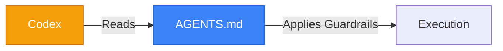

<div align="center">
# Codex Harness: Topos Protocol
**Enforcing Orchestration in Codex**
</div>


## 🌟 Status: Replicated from Source
The role files and ASCII decision graphs in this harness have been successfully replicated from the mature Claude source of truth. They have been stripped of Claude-specific YAML frontmatter and memory blocks to perfectly fit Codex's **Single-Model Role-Switching** paradigm.

## 📌 Implementation
Codex utilizes rule engines and global text policies. We inject the Topos constraints directly into its global space.




## 🏗️ Agent Formatting (Source of Truth)
Unlike Claude Code or Antigravity which support true isolated subagents, **Codex operates as a single orchestrating agent**. It does not spawn separate subagent binaries.

Instead, the orchestration is enforced via **Role Switching**:
1. The global macro rules are placed in `AGENTS.md`.
2. The specific role rules are placed in `~/.codex/agentic-pipeline/roles/<role>.md`.

**Format Pattern (`roles/archon.md`):**
Codex role files are plain Markdown without YAML frontmatter. They must strictly define the "Invariants", "Inputs", and "Outputs" for the role, as the single LLM context window must digest them sequentially to change its own behavior.

## 🧭 Operating Premises (Tool Reach)
Every run is bound by the three premises in `codex/AGENTS.md`: **P0** the pipeline returns a
validated artifact and leaves design decisions to the user; **P1 Tool Reach** — an agent
inventories its tools (shell under the current `sandbox_mode`, MCP servers) and picks the
standard or non-conventional path that reach allows, declaring the blast radius; privilege
changes (sandbox mode, approval policy) are user-gated and never a path choice; **P2 Pipeline
Modes** — Full (Archon→…→Hermon) or Short (Archon/Ontos dropped, inline planning) to control
budget. See `codex/AGENTS.md` for the full text.

## 🚀 Setup
Deploy to the Codex root:
```bash
cp codex/AGENTS.md ~/.codex/AGENTS.md
mkdir -p ~/.codex/agentic-pipeline/roles/
cp codex/roles/*.md ~/.codex/agentic-pipeline/roles/
```