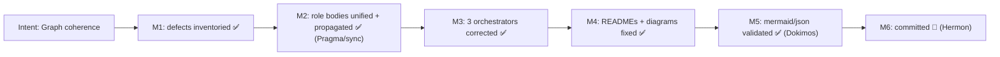
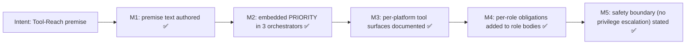
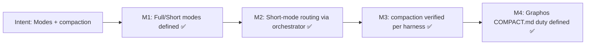
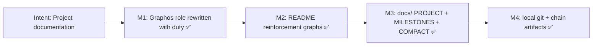

# MILESTONES — per intent and per agent

> Maintained by the Graphos role. `✅` done, `🔄` in progress, `⛔` blocked, `⬜` pending.

## Intent: Graph coherence across all harnesses

## Intent: Tool-Reach premise (PRIORITY P1)

## Intent: Pipeline Modes (P2) + compaction

## Intent: Graphos project-documentation duty

## Per-agent milestone summary

| Agent | Role milestones (reinforcement graph in each role body) |
|-------|---------------------------------------------------------|
| Archon | context+tools inventoried → deps classified → path+blast radius → plan returned |
| Graphos | state recorded → docs/reinforcement graphs → COMPACT.md → chain linked |
| Ontos | traces → omissions/co-dep → tool-reach audit → verdict |
| Pragma | tools declared → dry run → code → static-verify → report |
| Dokimos | env provisioned → suites → executed+RCA → verdict |
| Hermon | diff grouped → atomic commits → dependency order → report |
