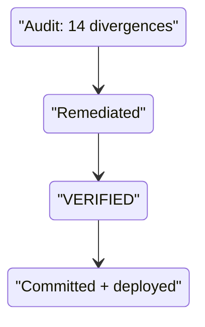

# feature_20261024_233537 — Cross-harness parity remediation

Previous: [feature_20261023_022200.md](feature_20261023_022200.md)
Mode: **Short** (pipeline under remediation; chat/orchestrator executed inline, Dokimos-style
checks run before commit). Path: standard (scripted regeneration from canonical text).

## Blast radius
`claude/CLAUDE.md`, `claude/{Archon,Ontos,Pragma,Hermon}.md` (descriptions + shared body rules),
`claude/README.md`, `codex/AGENTS.md`, `codex/README.md`, `gemini/gemini-cli/GEMINI.md`,
`gemini/README.md`, `gemini/antigravity/workflows/{ontos,pragma,hermon}.md` (descriptions),
role copies via `scripts/sync_roles.py`, `README.md`, `docs/`. Deployed copies refreshed under
`~/.claude`, `~/.codex`, `~/.gemini` (backups taken). No push.

## Divergences closed (audit of 2026-10-24)
1. Flow Variants in Codex/Gemini omitted Graphos; Gemini lacked Short Flow.
2. Rule 11 differed (Harness Evasion vs Chat Agent Intercession) → Rule 11 + Rule 12 everywhere.
3-4. Gemini rules/error recovery not mode-aware; Rule 6 outdated in Codex/Gemini.
5-9. Scrutator, Error Recovery, Abstract Study, cascade privilege clause, push user-gating truncated.
10-11. Claude-only semantics in shared role bodies (agent-memory rule, sub-executor spawning).
12-14. README errors (`.agents/<name>/agent.json` path, Gemini CLI omission, Graphos description,
Codex graph).
Extra: Claude Code subagents are chosen on demand by the orchestrator from each agent's
`description`; nested sub-agents allowed (3 levels); `Workspace: share` replaced by
`isolation: "worktree"` (Claude) / `git worktree add` (Codex, Gemini).

## Verification
21/21 parity checks across the 3 orchestrators; `sync_roles.py --check` PASS; 6/6 agent.json
valid; changed mermaid diagrams render (valid).

