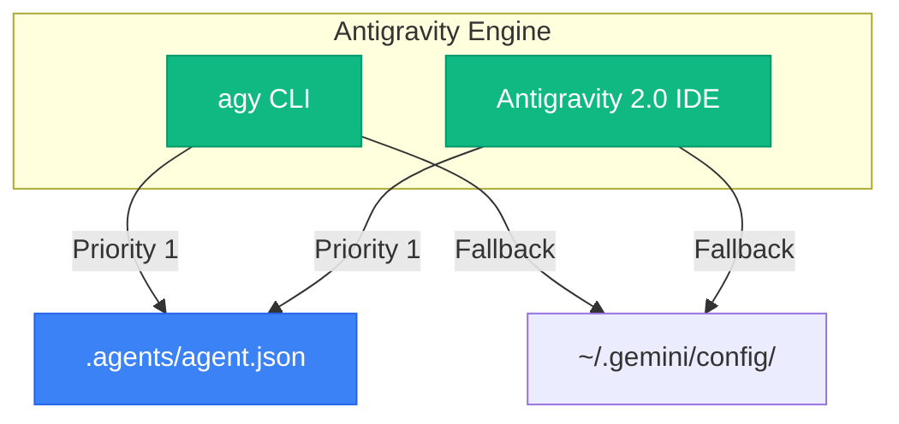

<div align="center">
# Antigravity (Gemini) Harness: Topos Protocol
**True Async Multi-Agent Execution**
</div>


## 🌟 Status: Replicated from Source
The agent system prompts and topological graphs in this harness have been successfully replicated from the mature Claude source of truth. They are converted into JSON blocks for `.agents/` and injected with Antigravity-specific model mappings (`pro` for execution/auditing, `flash` for fast documentation/version control), achieving True Async Multi-Agent Execution.

## 📌 Implementation
This harness bridges the gap between legacy CLI Sequential Role-Switching and True Async Orchestration via `.agents/agent.json`.




## 🏗️ Agent Formatting (Source of Truth)
Antigravity supports two discovery mechanisms for agents: `agent.json` or `agent.md`.

**Format A: JSON Structure (`.agents/agents/<name>/agent.json`)**
```json
{
  "name": "graphos",
  "description": "Documentalist agent. Tracks plan revisions.",
  "system_prompt": "Markdown instructions here...",
  "enable_write_tools": true,
  "enable_subagent_tools": false,
  "enable_mcp_tools": true
}
```

**Format B: Markdown with Frontmatter (`~/.gemini/config/agents/<name>/agent.md`)**
```markdown
---
name: graphos
description: Documentalist agent.
enable_write_tools: true
---
# Graphos System Prompt
[Instructions here...]
```
Unlike Claude Code, Antigravity uses Progressive Disclosure: `.agents/` inside the local workspace ALWAYS overrides the global `~/.gemini/config/` definitions.

## 🧭 Operating Premises (Tool Reach)
Every run is bound by the three premises in `gemini/gemini-cli/GEMINI.md`: **P0** the pipeline
returns a validated artifact and leaves design decisions to the user; **P1 Tool Reach** — an
agent inventories its tools (per-agent `enable_*` flags in Antigravity, shell + MCP in Gemini
CLI) and picks the standard or non-conventional path that reach allows, declaring the blast
radius; privilege changes are user-gated and never a path choice; **P2 Pipeline Modes** — Full
or Short to control budget.

> **Assumption — `enable_shell_tools`:** this field appears in `.agents/dokimos/agent.json`
> but could not be confirmed in official Antigravity documentation (checked 2026-10; the
> Gemini-API Antigravity agent documents shell via the managed `environment`, not a per-agent
> flag). Pragma and Hermon do not set it. If they need shell access, verify the field against
> current Antigravity docs first and treat enabling it as a user configuration decision — the
> pipeline does not add it speculatively.

## 🚀 Setup
The `.agents` folder works natively. To deploy the global fallback:
```bash
cp gemini/gemini-cli/GEMINI.md ~/.gemini/GEMINI.md
```